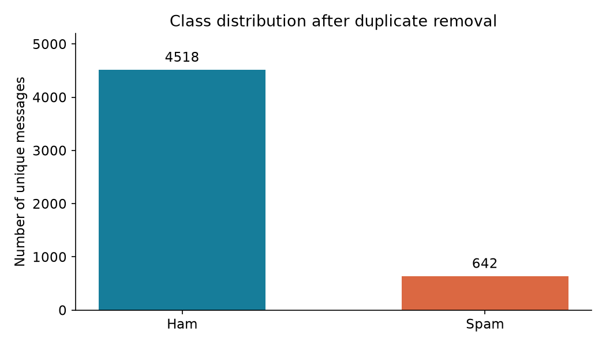
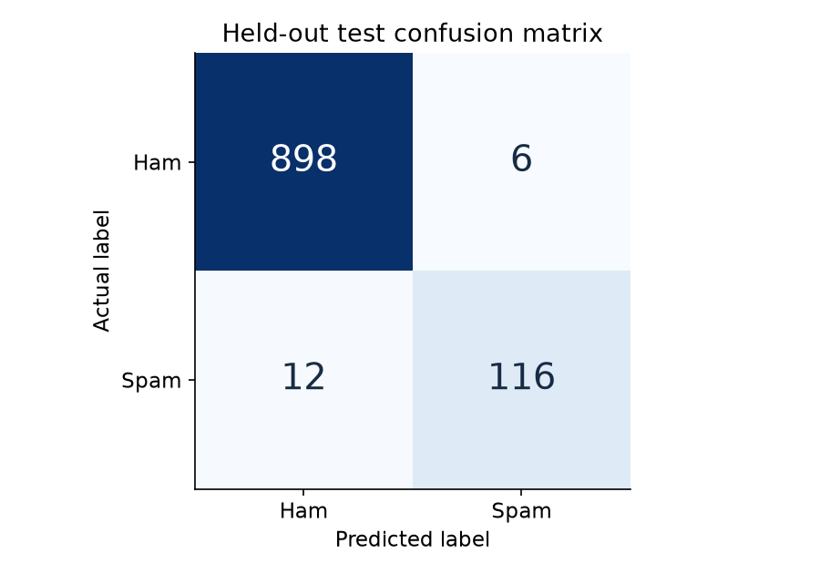

# Probabilistic SMS Spam Detection

**Yuvraj Chandak · 25BCE2561**  
BAMAT207 Probability and Statistics · Dr. Veeramani S  
Vellore Institute of Technology, Vellore

A reproducible Python project connecting empirical probability, Bayes' theorem, a Bernoulli random variable and Multinomial Naive Bayes text classification. The executable project and written report are separate deliverables.

## Start here

On this computer, double-click **`project/START_DEMO.cmd`**. The saved model and source dataset are included. Once dependencies are installed, the demo and training work offline.

On another Windows computer, install Python 3.12 (with Tkinter and Python on PATH), then double-click `project/SETUP.cmd`. Internet access is required for this initial dependency installation. After setup, use `START_DEMO.cmd`.

Cross-platform commands, from the repository root:

```sh
cd project
python -m venv .venv
# Windows: .venv\Scripts\activate
# macOS/Linux: source .venv/bin/activate
python -m pip install -r requirements.txt
python spam_detector.py train
python -m unittest discover -s tests -v
python demo.py
```

Linux may need the operating system's `python3-tk` package. If a graphical desktop is unavailable, use the terminal:

```sh
python spam_detector.py interactive
python spam_detector.py predict "Congratulations! You have won a free prize. Claim now."
```

## Measured results

Official source: 5,574 rows. After trimming surrounding message whitespace and removing 414 exact duplicate texts: **5,160 messages**, including **4,518 ham and 642 spam**. No missing or empty messages and no conflicting labels were found.

The stratified split uses 4,128 training and 1,032 test messages, `random_state=42`. CountVectorizer is fitted only on training messages. The saved pipeline is the evaluated training-only model.

| Test measurement | Value |
|---|---:|
| Accuracy | 98.26% |
| Always-ham baseline accuracy | 87.60% |
| Spam precision | 95.08% |
| Spam recall | 90.625% |
| Spam F1 | 92.80% |
| True negatives / false positives | 898 / 6 |
| False negatives / true positives | 12 / 116 |




## Probability results

`P(Spam)=642/5160=0.12441860`, `P(Ham)=0.87558140`. For `Y=1` for spam, `E(Y)=0.12441860` and `Var(Y)=0.10893862`.

| Word | All messages containing word | Spam messages | P(Spam given word) |
|---|---:|---:|---:|
| free | 199 | 144 | 0.723618 |
| prize | 70 | 70 | 1.000000 |
| win | 53 | 47 | 0.886792 |
| urgent | 61 | 56 | 0.918033 |
| offer | 30 | 24 | 0.800000 |

Word events are case-insensitive whole-word matches counted once per message. Each probability is verified using Bayes' theorem. These full-corpus descriptive results do not enter model fitting or tuning. An observed probability of 1 for `prize` is not a guarantee about future messages.

## Deliverables

- `project/SMS_Spam_Detection.ipynb`: executed instructional notebook, all eight assignment activities.
- `project/spam_detector.py`: reusable analysis/training/prediction source.
- `project/demo.py`: desktop interface with live probabilities and token explanations.
- `project/data/`: original UCI source, attribution, readme and cleaned dataset.
- `project/models/spam_pipeline.joblib`: trained pipeline.
- `project/results/`: three charts, exact metrics, five word calculations, split manifest, all held-out predictions and 18 errors.
- `project/tests/`: six automated correctness tests.
- `project/DEMO_GUIDE.md`: presentation script and viva questions.
- `report/SMS_Spam_Detection_Report.docx` and `.pdf`: separate detailed academic report.

## Notebook and Colab

Open `project/SMS_Spam_Detection.ipynb` in Jupyter or VS Code and select a Python environment with the requirements installed. For Colab, upload and extract the submission ZIP, change into its `project` directory and install requirements, then run the notebook's cells in order. A single notebook upload without `spam_detector.py` and the data directory is insufficient. Saved outputs allow the notebook to be read without executing it.

## Reproducibility and tests

Recorded Python version: 3.12.14. The package pins are in `project/requirements.txt`; `results/metrics.json` also records core versions and the raw file SHA256. Running `train` rebuilds all numerical artifacts and the model. The report builder reads these artifacts; if the analysis changes, regenerate and recheck both report formats.

Tests verify cleaning arithmetic, whole-word counts, Bayes equality, split disjointness, training-only vocabulary, model probability reconstruction, invalid input and saved evaluation consistency. Test scores describe one split; near-duplicate templates may remain. Model probabilities are not calibrated guarantees.

## Troubleshooting

- Missing module: use the same Python environment for installation and execution, or rerun `SETUP.cmd`.
- Missing model/results: run `python spam_detector.py train`.
- Tkinter unavailable: use terminal prediction or install Tk support for your Python distribution.
- Model version mismatch: install pinned requirements or retrain locally. Never load an untrusted joblib file.
- No recognized terms: the demo explicitly reports that prediction is based only on training priors.
- No internet: keep the bundled source data and use an environment where dependencies are already installed.

## Repository submission

Intended repository: https://github.com/YuvrajC7/sms-spam-detection

Open the repository in a browser before submission and verify the notebook, source, results, model and both report files are present. If publication is pending, sign in with `gh auth login` and push the prepared local commit. Do not share credentials or tokens in the project.

## References and attribution

Almeida and Hidalgo (2011), [SMS Spam Collection](https://doi.org/10.24432/C5CC84), UCI, CC BY 4.0. See `project/data/ATTRIBUTION.md` for transformations and attribution. Method references: [CountVectorizer](https://scikit-learn.org/stable/modules/generated/sklearn.feature_extraction.text.CountVectorizer.html), [Naive Bayes](https://scikit-learn.org/stable/modules/naive_bayes.html), [train_test_split](https://scikit-learn.org/stable/modules/generated/sklearn.model_selection.train_test_split.html).
